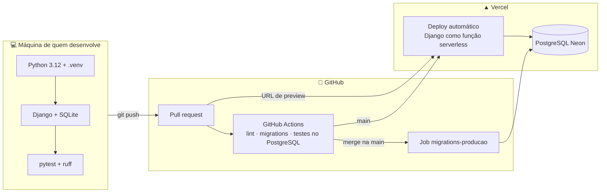

# Configuração do ambiente

Este guia explica como o ambiente do Barbearia Agendamento está montado: o que roda na máquina de quem desenvolve, o que roda no CI e o que roda em produção. A ideia é que qualquer pessoa da equipe (ou de fora dela) consiga subir o projeto do zero e entender por que cada peça está ali. Isso atende ao critério C4 ("ambiente reproduzível por terceiros").

## Visão geral



| Ambiente | Banco | `DEBUG` | Para quê |
|---|---|---|---|
| Local | SQLite (`src/db.sqlite3`) | `true` | Desenvolver e testar rápido |
| CI (GitHub Actions) | PostgreSQL 16 (container) | `false` | Garantir que lint, migrations e testes passam como em produção |
| Produção (Vercel) | PostgreSQL Neon | `false` | Site público: <https://barbearia-agendamento-phi.vercel.app> |

## Stack e versões

As versões estão fixadas no `requirements.txt` e no `pyproject.toml`, para que todo mundo rode exatamente o mesmo código (risco R7 do plano de gestão).

| Peça | Versão | Papel |
|---|---|---|
| Python | 3.12 | Linguagem (`.python-version`) |
| Django | 5.2 (LTS) | Framework web: páginas, admin, ORM, autenticação |
| psycopg | 3.3 | Driver do PostgreSQL |
| dj-database-url | 3.1 | Lê a `DATABASE_URL` e monta a configuração do banco |
| whitenoise | 6.12 | Serve CSS/JS/imagens sem servidor separado |
| python-dotenv | 1.2 | Carrega o arquivo `.env` local |
| bcrypt | 5.0 | Hash de senha (RNF02) |
| pytest + pytest-django + pytest-cov | 9.2 / 4.14 / 7.1 | Testes e cobertura |
| ruff | 0.17 | Lint e formatação |

Justificativas: [ADR 0001 – Stack](adr/0001-stack-tecnologica.md) e [ADR 0002 – Vercel](adr/0002-hospedagem-vercel.md).

## Estrutura do código

```
src/
├── manage.py
├── config/            configurações do projeto
│   ├── settings.py    tudo que muda entre ambientes vem de variáveis de ambiente
│   ├── urls.py        rotas: /, /saude/, /admin/
│   └── wsgi.py        ponto de entrada (a Vercel carrega este arquivo)
├── contas/            usuário customizado (login por e-mail, papéis)
├── core/              página inicial e healthcheck
└── templates/         layout base (Bootstrap, visual do protótipo)
tests/                 testes automatizados (pytest)
```

O usuário customizado (`contas.Usuario`) já segue a tabela `usuario` do [modelo de dados](modelo-de-dados.md): login por e-mail, `nome`, `telefone` e `papel` (cliente, barbeiro ou admin). Ele foi criado antes da primeira migration de propósito: o Django não permite trocar o modelo de usuário depois sem refazer o banco.

## Rodando na sua máquina

Pré-requisito: Python 3.12 (no Windows: `winget install Python.Python.3.12`).

```bash
# 1. Ambiente virtual e dependências
python -m venv .venv
source .venv/bin/activate          # Windows (Git Bash): source .venv/Scripts/activate
pip install -r requirements-dev.txt

# 2. Variáveis de ambiente
cp .env.example .env
#    gere a SECRET_KEY e cole no .env:
python -c "import secrets; print(secrets.token_urlsafe(50))"

# 3. Banco, usuário admin e servidor
python src/manage.py migrate
python src/manage.py createsuperuser
python src/manage.py runserver
```

Abra <http://127.0.0.1:8000>. O admin fica em `/admin` e o healthcheck em `/saude/`.

## Variáveis de ambiente

O código não tem nenhum segredo. Tudo vem de variáveis: no `.env` local (que **nunca** vai para o Git) ou no painel da Vercel.

| Variável | Local | Produção | O que faz |
|---|---|---|---|
| `DEBUG` | `true` | `false` | Liga mensagens de erro detalhadas. Em `false`, ativa as proteções de produção |
| `SECRET_KEY` | qualquer valor longo | gerada e guardada como *sensível* na Vercel | Assina sessões e tokens. Sem ela, com `DEBUG=false`, o app **se recusa a subir** |
| `DATABASE_URL` | vazia (usa SQLite) | criada pela integração Neon | Endereço do PostgreSQL. Na Vercel, se faltar, o app para com uma mensagem clara (SQLite perderia os dados) |
| `ALLOWED_HOSTS` | `localhost,127.0.0.1` | automático (`*.vercel.app`) | Domínios aceitos |
| `CSRF_TRUSTED_ORIGINS` | vazia | automático (`https://*.vercel.app`) | Origens aceitas em formulários |

## Segurança já configurada

| Proteção | Como |
|---|---|
| Senhas com bcrypt (RNF02) | `BCryptSHA256PasswordHasher`; mínimo de 8 caracteres e validação contra senhas comuns |
| HTTPS obrigatório | Em produção, HTTP redireciona para HTTPS; cookies só trafegam por HTTPS |
| Sem segredos no repositório | `.env` e `.env.local` no `.gitignore`; `.vercelignore` impede o upload deles |
| Falha segura | Sem `SECRET_KEY` ou sem banco em produção, o app não sobe, em vez de subir inseguro |
| HSTS | Desligado de propósito: só deve ser ligado com domínio próprio, porque é difícil de reverter |

## Testes e qualidade

```bash
pytest              # testes + relatório de cobertura (falha abaixo de 60%, RNF04)
ruff check .        # lint
ruff format .       # formatação automática
```

Hoje são **10 testes**, com cobertura de **~92%**. Eles cobrem a página inicial e a responsividade (RNF03), o healthcheck com banco, o login por e-mail, o bcrypt (RNF02), o superusuário, o redirecionamento HTTPS e a configuração específica da Vercel.

## CI – GitHub Actions

Arquivo: `.github/workflows/ci.yml`. Roda em **todo pull request** e em **todo push na `main`**:

1. **Lint:** `ruff check` e `ruff format --check`
2. **Migrations em dia:** falha se alguém mudou um model e esqueceu de gerar a migration
3. **Testes contra PostgreSQL 16:** o mesmo banco da produção, com `DEBUG=false`
4. **`migrations-producao`** (só na `main`, depois dos testes): aplica as migrations no Neon

O passo 4 existe porque a Vercel não tem uma etapa de "pré-deploy" onde rodar `migrate`. Ele usa os secrets `DATABASE_URL_PRODUCAO` e `SECRET_KEY_PRODUCAO` do GitHub.

## Deploy – Vercel

- **Automático:** todo merge na `main` publica em produção. Todo pull request ganha uma URL de preview para revisar.
- **Como o Django roda:** a Vercel detecta o `manage.py` e roda `src/config/wsgi.py` como **função serverless**. As dependências são instaladas pelo `pyproject.toml`, que deve ficar igual ao `requirements.txt`.
- **Banco:** PostgreSQL **Neon**, criado pela Vercel Storage, que injeta a `DATABASE_URL` no projeto.
- **Arquivos estáticos:** o WhiteNoise serve direto das pastas dos apps (`WHITENOISE_USE_FINDERS`), sem `collectstatic`.
- **Conexões:** `CONN_MAX_AGE = 0`, porque cada requisição pode cair numa instância nova.

### Problemas encontrados no primeiro deploy (e como foram resolvidos)

| Erro | Causa | Solução |
|---|---|---|
| `No module named 'django'` no build | A Vercel instala as dependências pelo `pyproject.toml`, que estava sem a lista | Dependências declaradas no `pyproject.toml` |
| `No module named 'config'` | A Vercel carrega o `wsgi.py` a partir da raiz do repositório, e `src/` não estava no caminho | O `wsgi.py` adiciona `src/` ao `sys.path` |
| 404 em todas as páginas | Um rewrite no `vercel.json` mandava tudo para `/api/index` | Removidos o rewrite e o `api/index.py`; o suporte nativo da Vercel a Django já roteia |
| 301 nos testes do CI | O CI roda com `DEBUG=false`, então HTTP vira HTTPS | Testes usam `secure=True`, mais um teste próprio do redirecionamento |
| App sem banco com `DATABASE_URL=` vazia | A biblioteca tratava string vazia como "sem banco" | Valor vazio é tratado como ausente (cai no SQLite local) |

## Verificando se está tudo no ar

```bash
curl https://barbearia-agendamento-phi.vercel.app/saude/
# {"status": "ok", "banco": "ok"}
```

Se `banco` vier `"erro"` (HTTP 503), a aplicação subiu, mas não conseguiu falar com o PostgreSQL. Nesse caso, confira a `DATABASE_URL` no painel da Vercel.
