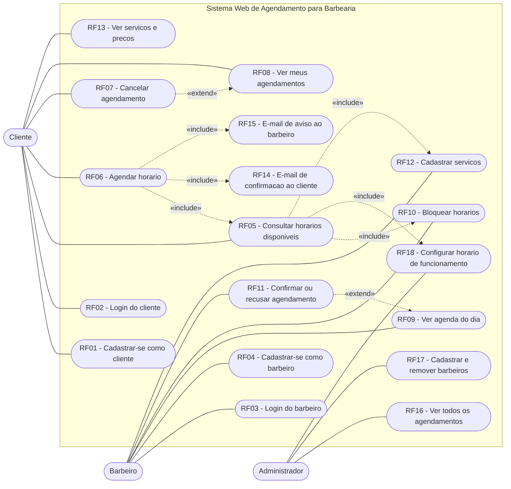
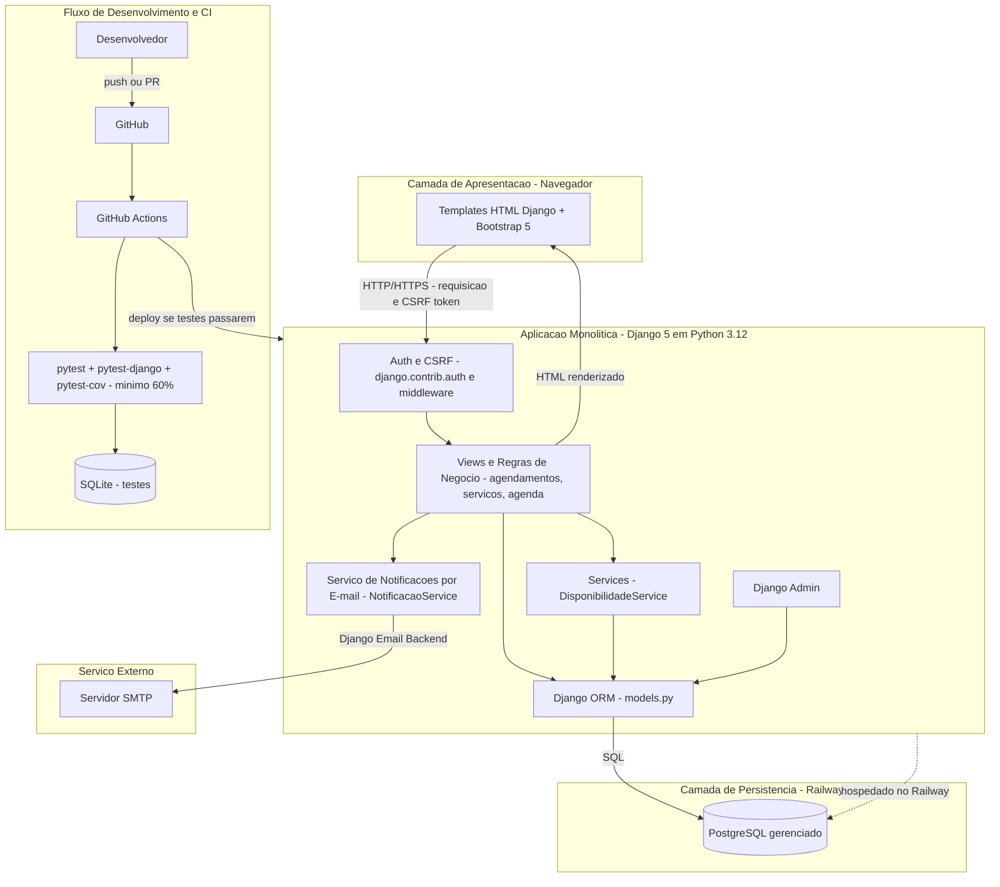
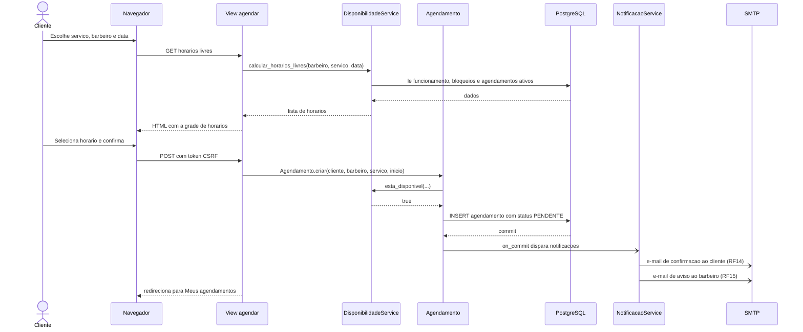

# Arquitetura e Modelagem UML — Sistema Web de Agendamento para Barbearia

> **Artefato referente à Issue #30 (IT1).** Contempla: Diagrama de Casos de Uso, Diagrama de Classes (Django ORM), Diagrama de Arquitetura, Fluxo de Sequência e Matriz de Rastreabilidade (`RF01`–`RF18`).  
> **Base tecnológica:** ADR 0001 (Python 3.12, Django 5, Bootstrap 5, SQLite/PostgreSQL, pytest, GitHub Actions e Railway).

## Sumário

1. [Premissas de Modelagem e Domínio](#1-premissas-de-modelagem-e-domínio)
2. [Diagrama de Casos de Uso (UML)](#2-diagrama-de-casos-de-uso-uml)
3. [Diagrama de Classes — Django ORM (UML)](#3-diagrama-de-classes--django-orm-uml)
4. [Diagrama de Arquitetura e Fluxo Principal](#4-diagrama-de-arquitetura-e-fluxo-principal)
5. [Tabela de Rastreabilidade (Requisitos × Diagramas)](#5-tabela-de-rastreabilidade-requisitos--diagramas)

---

## 1. Premissas de Modelagem e Domínio

As entidades e atributos abaixo consolidam o modelo de dados oficial do sistema para implementação em `models.py`:

- **Usuário único (`Usuario`):** Estende `AbstractUser` com o campo `papel` (`CLIENTE`, `BARBEIRO`, `ADMIN`), atendendo `RF01`, `RF02` e `RF03` com a autenticação nativa do Django. O administrador utiliza `is_staff` / `is_superuser` e opera pelo Django Admin.
- **Barbeiro (`Barbeiro`):** Perfil vinculado `OneToOne` com `Usuario`, armazenando `nome` e `especialidade` (`RF04`). Pode se cadastrar pelo formulário público (`RF04`) ou ser gerenciado pelo administrador (`RF17`). A remoção é **lógica** (`ativo = False`) para preservar o histórico de agendamentos (`on_delete=PROTECT`).
- **Serviço (`Servico`):** Vinculado a um barbeiro (`ForeignKey`), contendo `nome`, `preco` e `duracao_minutos` (`RF12`). A listagem pública (`RF13`) exibe apenas os serviços ativos.
- **Agendamento (`Agendamento`):** Armazena `inicio` e `fim` calculados (`inicio + servico.duracao_minutos`) e `preco_cobrado` como registro histórico do valor no momento da reserva. Estados válidos: `PENDENTE`, `CONFIRMADO`, `RECUSADO`, `CANCELADO` e `CONCLUIDO`.
- **Cálculo de horários livres (`DisponibilidadeService` — `RF05`):** Serviço de domínio que cruza o horário de funcionamento da barbearia (`RF18`), os bloqueios do barbeiro (`RF10`), os agendamentos ativos (`PENDENTE` ou `CONFIRMADO`) e a duração do serviço escolhido (`RF12`).
- **Notificações transacionais (`NotificacaoService` — `RF14`, `RF15`):** Realiza o disparo de e-mails via Django Email Backend dentro de `transaction.on_commit`, garantindo que o aviso só ocorra após a gravação no banco e que eventuais falhas de SMTP não revertam o agendamento.
- **Controle de concorrência:** A criação de agendamentos executa dentro de `transaction.atomic` com revalidação de conflito de horário antes do `INSERT`.

---

## 2. Diagrama de Casos de Uso (UML)

Representação dos três atores do sistema (**Cliente**, **Barbeiro** e **Administrador**) e dos 18 requisitos funcionais (`RF01`–`RF18`), incluindo relações de inclusão (`«include»`) e extensão (`«extend»`).

### Leitura das Relações UML

| Relação | Tipo | Justificativa |
| :--- | :--- | :--- |
| `RF06` $\rightarrow$ `RF05` | `«include»` | Todo agendamento exige a validação de disponibilidade para o horário selecionado. |
| `RF06` $\rightarrow$ `RF14`, `RF15` | `«include»` | Todo agendamento concluído dispara os e-mails de confirmação ao cliente e aviso ao barbeiro. |
| `RF05` $\rightarrow$ `RF10`, `RF18`, `RF12` | `«include»` | O cálculo de horários livres depende dos bloqueios, do horário de funcionamento e da duração do serviço. |
| `RF07` $\rightarrow$ `RF08` | `«extend»` | O cancelamento é acionado opcionalmente a partir da listagem de agendamentos do cliente. |
| `RF11` $\rightarrow$ `RF09` | `«extend»` | A confirmação ou recusa de um corte é acionada a partir da agenda diária do barbeiro. |

---

## 3. Diagrama de Classes — Django ORM (UML)

Modelagem estrutural das entidades persistentes (`models.py`), enumerações e serviços de domínio (`services.py`).

```mermaid
classDiagram
    direction LR

    class PapelUsuario {
        <<enumeration>>
        CLIENTE
        BARBEIRO
        ADMIN
    }

    class StatusAgendamento {
        <<enumeration>>
        PENDENTE
        CONFIRMADO
        RECUSADO
        CANCELADO
        CONCLUIDO
    }

    class Usuario {
        <<Model - AbstractUser>>
        +BigAutoField id
        +CharField username
        +CharField first_name
        +EmailField email
        +CharField password
        +CharField papel
        +CharField telefone
        +BooleanField is_staff
        +BooleanField is_active
        +DateTimeField date_joined
        +eh_cliente() bool
        +eh_barbeiro() bool
        +eh_admin() bool
    }

    class Barbeiro {
        <<Model>>
        +BigAutoField id
        +OneToOneField usuario
        +CharField nome
        +CharField especialidade
        +BooleanField ativo
        +horarios_livres(servico, data) list
        +agenda_do_dia(data) QuerySet
        +bloquear_horario(inicio, fim, motivo) BloqueioHorario
        +desativar() void
    }

    class Servico {
        <<Model>>
        +BigAutoField id
        +ForeignKey barbeiro
        +CharField nome
        +DecimalField preco
        +PositiveIntegerField duracao_minutos
        +BooleanField ativo
        +duracao() timedelta
    }

    class Agendamento {
        <<Model>>
        +BigAutoField id
        +ForeignKey cliente
        +ForeignKey barbeiro
        +ForeignKey servico
        +DateTimeField inicio
        +DateTimeField fim
        +CharField status
        +DecimalField preco_cobrado
        +DateTimeField criado_em
        +DateTimeField atualizado_em
        +criar(cliente, barbeiro, servico, inicio) Agendamento
        +confirmar() void
        +recusar() void
        +cancelar(por) void
        +conflita_com(inicio, fim) bool
        +esta_ativo() bool
        +eh_futuro() bool
        +clean() void
    }

    class BloqueioHorario {
        <<Model>>
        +BigAutoField id
        +ForeignKey barbeiro
        +DateTimeField inicio
        +DateTimeField fim
        +CharField motivo
        +sobrepoe(inicio, fim) bool
        +clean() void
    }

    class HorarioFuncionamento {
        <<Model>>
        +BigAutoField id
        +PositiveSmallIntegerField dia_semana
        +TimeField abertura
        +TimeField fechamento
        +BooleanField fechado
        +clean() void
        +contem(inicio, fim) bool
    }

    class DisponibilidadeService {
        <<service>>
        +calcular_horarios_livres(barbeiro, servico, data) list
        +esta_disponivel(barbeiro, servico, inicio) bool
    }

    class NotificacaoService {
        <<service>>
        +notificar_cliente_agendamento(agendamento) void
        +notificar_barbeiro_agendamento(agendamento) void
        +notificar_cliente_status(agendamento) void
    }

    Usuario --> PapelUsuario : papel
    Agendamento --> StatusAgendamento : status

    Barbeiro "0..1" --> "1" Usuario : usuario OneToOne
    Servico "0..*" --> "1" Barbeiro : barbeiro FK
    BloqueioHorario "0..*" --> "1" Barbeiro : barbeiro FK
    Agendamento "0..*" --> "1" Usuario : cliente FK
    Agendamento "0..*" --> "1" Barbeiro : barbeiro FK
    Agendamento "0..*" --> "1" Servico : servico FK

    Barbeiro ..> DisponibilidadeService : delega
    Agendamento ..> DisponibilidadeService : valida horario
    Agendamento ..> NotificacaoService : dispara e-mails
    DisponibilidadeService ..> HorarioFuncionamento : le
    DisponibilidadeService ..> BloqueioHorario : le
    DisponibilidadeService ..> Agendamento : le ativos
```

### Regras de Integridade do Banco de Dados

| Modelo | Regra de Negócio | Implementação Django ORM |
| :--- | :--- | :--- |
| `Usuario` | E-mail único por conta | `email = EmailField(unique=True)` |
| `Barbeiro` | Um perfil de barbeiro por usuário | `OneToOneField(Usuario, on_delete=CASCADE)` |
| `Servico` | Preço e duração estritamente positivos | `CheckConstraint` (`preco > 0` e `duracao_minutos > 0`) |
| `Agendamento` | Horário final posterior ao inicial | `CheckConstraint` (`fim > inicio`) |
| `Agendamento` | Sem sobreposição de horário ativo para o mesmo barbeiro | Validação em `Agendamento.criar` com `transaction.atomic` |
| `Agendamento` | Preservação do histórico financeiro e operacional | Chaves estrangeiras com `on_delete=PROTECT` (remoção lógica via `ativo=False`) |
| `BloqueioHorario` | Horário final posterior ao inicial | `CheckConstraint` (`fim > inicio`) |
| `HorarioFuncionamento` | Registro único por dia da semana (`0` a `6`) | `UniqueConstraint` em `dia_semana` e validação `abertura < fechamento` |

### Máquina de Estados (`StatusAgendamento`)

| Estado Anterior | Novo Estado | Transição | Ator Responsável |
| :--- | :--- | :--- | :--- |
| *(novo registro)* | `PENDENTE` | `criar()` | Cliente (`RF06`) |
| `PENDENTE` | `CONFIRMADO` | `confirmar()` | Barbeiro (`RF11`) |
| `PENDENTE` | `RECUSADO` | `recusar()` | Barbeiro (`RF11`) |
| `PENDENTE` ou `CONFIRMADO` | `CANCELADO` | `cancelar()` | Cliente (`RF07`), válido apenas para horários futuros |
| `CONFIRMADO` | `CONCLUIDO` | Encerramento após o atendimento | Sistema / Barbeiro |

---

## 4. Diagrama de Arquitetura e Fluxo Principal

Visão de implantação e integração entre camadas (monolito Django 5, PostgreSQL, SMTP e pipeline CI/CD).

### Descrição das Camadas

| Camada | Responsabilidade |
| :--- | :--- |
| **Navegador (Templates + Bootstrap 5)** | Interface responsiva renderizada no servidor. Formulários protegidos com ``, vitrine de serviços, grade de horários, agenda diária e histórico. |
| **Auth e CSRF** | `django.contrib.auth` gerencia cadastro, login e sessões (`RF01`–`RF03`). Mixins e decoradores controlam o acesso por `papel` (`CLIENTE`, `BARBEIRO`, `ADMIN`). |
| **Views e Regras de Negócio** | Orquestram os fluxos HTTP de marcação, cancelamento, confirmação/recusa, bloqueio de agenda e cadastro de serviços. |
| **Django Admin** | Painel administrativo nativo utilizado pelo administrador para gestão de barbeiros, horários de funcionamento e consulta global de agendamentos (`RF16`–`RF18`). |
| **Serviço de Notificações** | Envia e-mails transacionais (`RF14`, `RF15`) via Django Email Backend (console em desenvolvimento; SMTP em produção). |
| **Django ORM & PostgreSQL** | Mapeamento objeto-relacional executado sobre SQLite em desenvolvimento/CI e PostgreSQL gerenciado no Railway em produção. |
| **CI/CD (GitHub Actions + Railway)** | Cada *push* ou *Pull Request* dispara `pytest` com medição de cobertura ($\ge 60\%$). Estando verde, o Railway realiza o deploy contínuo. |

### Fluxo de Sequência: Agendamento e Notificação (`RF05`, `RF06`, `RF14`, `RF15`)

---

## 5. Tabela de Rastreabilidade (Requisitos × Diagramas)

| RF | Issue | Caso de Uso (Seção 2) | Classes / Modelos (Seção 3) | Componentes da Arquitetura (Seção 4) |
| :--- | :--- | :--- | :--- | :--- |
| **RF01** Cliente se cadastra | `#1` | `RF01` (Cliente) | `Usuario` (`papel=CLIENTE`) | Templates, Auth/CSRF, Views, ORM, PostgreSQL |
| **RF02** Cliente faz login | `#2` | `RF02` (Cliente) | `Usuario` | Templates, Auth/CSRF |
| **RF03** Barbeiro faz login | `#3` | `RF03` (Barbeiro) | `Usuario` (`papel=BARBEIRO`), `Barbeiro` | Templates, Auth/CSRF |
| **RF04** Barbeiro se cadastra (nome e especialidade) | `#4` | `RF04` (Barbeiro) | `Barbeiro` (`nome`, `especialidade`), `Usuario` | Templates, Auth/CSRF, Views, ORM |
| **RF05** Ver horários disponíveis | `#5` | `RF05` (Cliente) $\rightarrow$ `«include»` `RF10`, `RF12`, `RF18` | `DisponibilidadeService`, `Barbeiro`, `HorarioFuncionamento`, `BloqueioHorario`, `Agendamento`, `Servico` | Views, Services, ORM, PostgreSQL |
| **RF06** Agendar horário | `#6` | `RF06` (Cliente) $\rightarrow$ `«include»` `RF05`, `RF14`, `RF15` | `Agendamento.criar`, `StatusAgendamento.PENDENTE`, `Usuario`, `Barbeiro`, `Servico` | Templates, Auth/CSRF, Views, Services, ORM, PostgreSQL |
| **RF07** Cancelar agendamento | `#7` | `RF07` (Cliente) $\rightarrow$ `«extend»` `RF08` | `Agendamento.cancelar`, `StatusAgendamento.CANCELADO` | Views, ORM |
| **RF08** Ver agendamentos futuros e passados | `#8` | `RF08` (Cliente) | `Agendamento` (`eh_futuro`, FK `cliente`) | Templates, Views, ORM |
| **RF09** Barbeiro vê agenda do dia | `#9` | `RF09` (Barbeiro) | `Barbeiro.agenda_do_dia`, `Agendamento` | Templates, Views, ORM |
| **RF10** Barbeiro bloqueia horários | `#10` | `RF10` (Barbeiro) | `BloqueioHorario`, `Barbeiro.bloquear_horario` | Templates, Views, ORM |
| **RF11** Confirmar ou recusar agendamento | `#11` | `RF11` (Barbeiro) $\rightarrow$ `«extend»` `RF09` | `Agendamento.confirmar`, `Agendamento.recusar`, `NotificacaoService` | Views, ORM, Serviço de Notificações |
| **RF12** Barbeiro cadastra serviços | `#12` | `RF12` (Barbeiro) | `Servico` (`nome`, `preco`, `duracao_minutos`, FK `barbeiro`) | Templates, Views, ORM |
| **RF13** Cliente vê serviços e preços | `#13` | `RF13` (Cliente) | `Servico` (`ativo=True`) | Templates, Views, ORM |
| **RF14** E-mail de confirmação ao cliente | `#14` | `RF14` (incluído por `RF06`) | `NotificacaoService.notificar_cliente_agendamento`, `Agendamento` | Serviço de Notificações, SMTP externo |
| **RF15** E-mail de aviso ao barbeiro | `#15` | `RF15` (incluído por `RF06`) | `NotificacaoService.notificar_barbeiro_agendamento`, `Agendamento`, `Barbeiro` | Serviço de Notificações, SMTP externo |
| **RF16** Admin vê todos os agendamentos | `#16` | `RF16` (Administrador) | `Agendamento` (`ModelAdmin`) | Django Admin, ORM, PostgreSQL |
| **RF17** Admin cadastra e remove barbeiros | `#17` | `RF17` (Administrador) | `Barbeiro` (`ativo`, `desativar`), `Usuario` | Django Admin, ORM, PostgreSQL |
| **RF18** Admin configura horário de funcionamento | `#18` | `RF18` (Administrador) | `HorarioFuncionamento` | Django Admin, ORM, PostgreSQL |

### Cobertura Transversal (Requisitos Não Funcionais)

| Aspecto Arquitetural | Onde está endereçado |
| :--- | :--- |
| **Segurança (autenticação, CSRF e autorização por papel)** | Camada `Auth e CSRF` (Seção 4) e campo `Usuario.papel` (Seção 3). |
| **Qualidade e cobertura de testes ($\ge 60\%$)** | Pipeline `GitHub Actions` com `pytest-cov` sobre SQLite (Seção 4). |
| **Portabilidade entre bancos (SQLite $\leftrightarrow$ PostgreSQL)** | Uso de `CheckConstraint`, `UniqueConstraint` e `transaction.atomic` portáveis no Django ORM (Seção 3). |
| **Resiliência no envio de e-mails** | Execução assíncrona lógica via `transaction.on_commit` no fluxo de agendamento (Seção 4). |