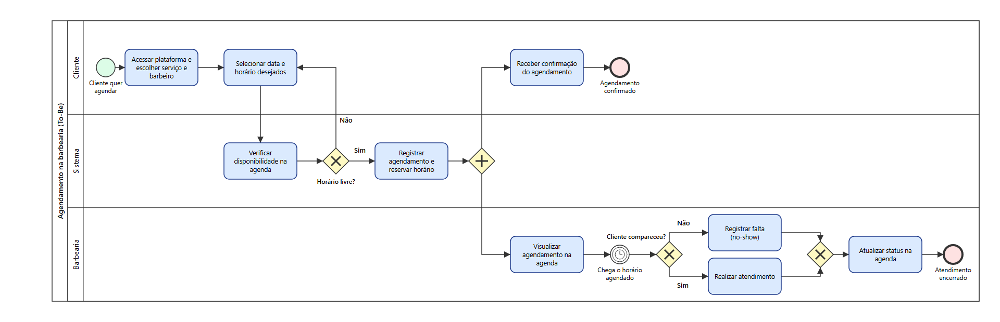

# BPMN – Processo de agendamento (To-Be)

Processo de negócio do agendamento com o sistema funcionando (cenário **To-Be**), em BPMN 2.0.

| Arquivo | O que é |
|---|---|
| `agendamento-to-be.bpmn` | Modelo BPMN 2.0 (XML com layout). Abre no **Bizagi Modeler** (Importar → BPMN), no [bpmn.io](https://demo.bpmn.io) e no Camunda Modeler |
| `agendamento-to-be.png` / `.svg` | Imagem do diagrama |
| `agendamento-to-be-v1.jpeg` | Primeira versão, feita pela equipe — mantida para mostrar a evolução do artefato |

## Raias

- **Cliente** — escolhe serviço, barbeiro, data e horário; recebe a confirmação.
- **Sistema** — verifica a disponibilidade e registra o agendamento.
- **Barbearia** — vê o agendamento, atende (ou registra a falta) e atualiza o status.

## O que mudou da v1 para a v2

| Problema na v1 | Correção na v2 |
|---|---|
| "Escolher novo horário" não tinha saída (caminho sem fim) | O "Não" de *Horário livre?* volta para *Selecionar data e horário* — o laço fecha |
| *Verificar disponibilidade* tinha duas saídas sem gateway, o que em BPMN significa caminhos **em paralelo**: a barbearia veria o agendamento mesmo com horário ocupado | A barbearia só recebe o agendamento depois de *Registrar agendamento* |
| "Comparecer à barbearia" não tinha saída nem ligação com *Cliente compareceu?* | Substituído pelo evento de tempo *Chega o horário agendado*, que leva ao gateway *Cliente compareceu?* |
| Depois de registrado, cliente e barbearia seguem ao mesmo tempo, mas isso não estava explícito | Gateway **paralelo** (+): o cliente recebe a confirmação enquanto a barbearia vê o agendamento |
| Junção implícita antes de *Atualizar status* | Gateway exclusivo (X) de junção, espelhando o de divisão |
| "Confirmar agendamento ou bloquear horário" misturava conceitos (bloqueio é a folga do barbeiro, RF10) | Renomeado para *Registrar agendamento e reservar horário* |
| Pool sem nome | Pool *Agendamento na barbearia (To-Be)* |

## Rastreabilidade com os requisitos

| Elemento do BPMN | Requisito |
|---|---|
| Acessar plataforma e escolher serviço e barbeiro | RF13 |
| Selecionar data e horário / Verificar disponibilidade / Horário livre? | RF05 |
| Registrar agendamento e reservar horário | RF06 |
| Receber confirmação do agendamento | RF14 |
| Visualizar agendamento na agenda | RF09, RF15 |
| Realizar atendimento / Registrar falta / Atualizar status | *A definir — não há RF para marcar atendimento ou falta (ver pendência abaixo)* |

> **Pendência:** o registro de falta (no-show) não existe ainda nos requisitos nem no modelo de dados. Decidir entre criar o RF19 (+ status `nao_compareceu` no agendamento) ou retirar a tarefa do diagrama.
