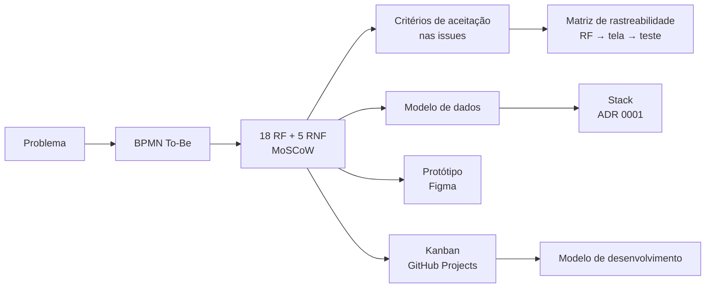
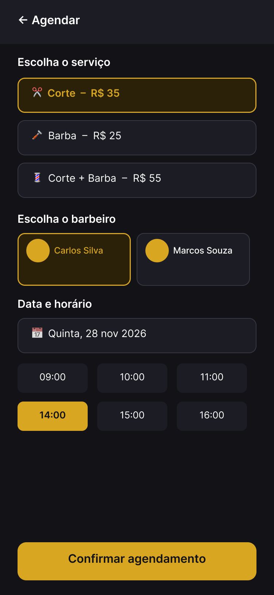
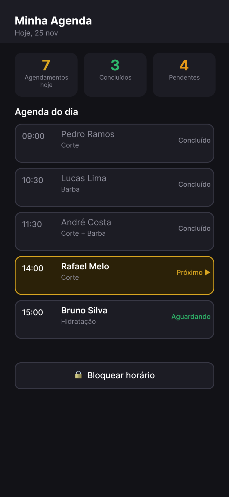

# Iteração 1 – Jornada e planejamento

**Projeto:** Barbearia Agendamento · **Opção B** (projeto pessoal com problema real)
**Disciplina:** Engenharia de Software · CEUB · Turma B · 2026/2
**Versão do repositório:** [`v0.1.0`](https://github.com/PedroBaliz/barbearia-agendamento/releases/tag/v0.1.0)
**Critérios observados nesta iteração:** C1, C2, C3 e C6
**Apresentação:** única, em 07/12/2026 (IT1, IT2 e IT3 juntas). Marcos internos: IT1 27/11 · IT2 03/12 · IT3 06/12

Este documento resume o que a equipe produziu na primeira iteração, onde está cada artefato e como eles se ligam. A ideia é que dê para seguir o caminho **problema → processo → requisitos → projeto** abrindo os links em ordem.

---

## 1. O problema

Barbearias pequenas controlam os horários por WhatsApp ou caderno. Isso gera:

- **conflitos de agenda**: dois clientes no mesmo horário, ou horário marcado com a barbearia fechada;
- **faltas sem registro**: o barbeiro não sabe quem costuma faltar;
- **tempo perdido**: o barbeiro para o atendimento para responder mensagens;
- **perda de clientes**: quem não recebe resposta rápido procura outra barbearia.

**Proposta:** um sistema web em que o cliente vê os horários realmente livres e agenda sozinho, o barbeiro acompanha a própria agenda e o admin configura o funcionamento da barbearia.

## 2. Como cada artefato leva ao próximo

## 3. Processo e requisitos (C2)

### 3.1 Processo de negócio – BPMN

- **Artefato:** [`docs/bpmn/`](../bpmn/), em BPMN 2.0 (`.bpmn`, abre no Bizagi) com imagem PNG/SVG.
- **Raias:** Cliente, Sistema e Barbearia.
- **Evolução:** a v1 feita pela equipe foi revisada. Foram corrigidos caminhos sem saída e uma bifurcação sem gateway, e entraram um gateway paralelo e um evento de tempo. A v1 ficou no repositório e a tabela do que mudou está no [README do BPMN](../bpmn/README.md).
- **Rastreabilidade:** cada tarefa do diagrama aponta para o RF correspondente.

### 3.2 Requisitos funcionais – backlog com MoSCoW

São 18 histórias de usuário, organizadas em 5 módulos (autenticação, agendamento, serviços, notificações e painel admin).

| Prioridade | Requisitos | Qtde |
|---|---|---|
| **Must** (MVP) | RF01, RF02, RF03, RF04, RF05, RF06, RF07, RF09, RF12, RF13, RF18 | 11 |
| **Should** | RF08, RF10, RF11, RF16, RF17 | 5 |
| **Could** | RF14, RF15 | 2 |
| **Won't** | pagamento online, fila de espera, avaliação de barbeiros | — |

- **Backlog:** [GitHub Projects](https://github.com/users/PedroBaliz/projects/3), com colunas Todo / In Progress / Done e um campo MoSCoW.
- **Histórias:** [issues #1 a #18](https://github.com/PedroBaliz/barbearia-agendamento/issues?q=is%3Aissue+label%3AMust%2CShould%2CCould).
- **Critérios de aceitação:** cada issue tem de 3 a 5 critérios no formato *Dado / Quando / Então*, além das tabelas do banco que usa e do teste automatizado que vai cobri-la.

Exemplo, RF06 (agendar horário):

> - Dado que estou logado como cliente, quando escolho serviço, barbeiro, data e um horário disponível e confirmo, então o agendamento é criado com status `pendente`, `fim = início + duração do serviço` e o preço atual do serviço.
> - Dado que outro cliente reservou o mesmo horário antes de eu confirmar, quando confirmo, então vejo "Horário não está mais disponível" e nada é gravado.
> - Não é possível agendar no passado.

### 3.3 Requisitos não funcionais

| ID | Requisito | Categoria |
|---|---|---|
| RNF01 | Carregar em menos de 3 segundos em conexão padrão | Performance |
| RNF02 | Senhas armazenadas com hash bcrypt | Segurança |
| RNF03 | Interface responsiva (funciona no celular) | Usabilidade |
| RNF04 | Suíte de testes cobrindo no mínimo 60% do código | Qualidade |
| RNF05 | Sistema disponível em link público (deploy) | Disponibilidade |

### 3.4 Modelo de desenvolvimento

- **Artefato:** [`docs/modelo-de-desenvolvimento.md`](../modelo-de-desenvolvimento.md).
- **Decisão:** desenvolvimento **iterativo e incremental**, com práticas do Scrum (sprints de 1 semana, planning, retrospectiva) e um quadro Kanban com limite de 2 cards em andamento por pessoa.
- **Por que não cascata:** o maior risco, que é o cálculo de horários livres (RF05/RF06), só se revela com o código rodando. Por isso os *Must* são construídos e testados primeiro.
- **Definição de Pronto:** critérios de aceitação atendidos, teste passando no GitHub Actions, PR revisado por outro integrante e matriz de rastreabilidade atualizada.

## 4. Projeto do sistema (C3)

### 4.1 Stack e arquitetura

- **Artefato:** [ADR 0001 – Stack tecnológica](../adr/0001-stack-tecnologica.md).
- **Decisão:** monolito web em **Python 3.12 + Django 5**, com templates e Bootstrap 5, PostgreSQL em produção (SQLite em desenvolvimento), pytest + GitHub Actions e deploy na Vercel (ADR 0002).
- **Justificativa principal:** o Django traz autenticação, ORM, migrations e **painel admin** prontos, e o admin cobre RF16, RF17 e RF18. Assim o esforço vai para as regras de agendamento. Também foram avaliadas e descartadas as alternativas Flask, FastAPI + React e Node.js (os motivos estão no ADR).

### 4.2 Modelo de dados

- **Artefato:** [`docs/modelo-de-dados.md`](../modelo-de-dados.md), com diagrama ER, dicionário de dados e regras de negócio.
- **Tabelas:** `usuario`, `barbeiro`, `servico`, `horario_funcionamento`, `bloqueio_horario` e `agendamento`. Cada tabela lista os RF que dependem dela.
- **Regras centrais:** agendamentos do mesmo barbeiro não se sobrepõem; o agendamento cabe dentro do horário de funcionamento e não cruza bloqueios; o serviço pertence ao barbeiro escolhido.

### 4.3 Protótipo de interface

- **Artefato:** [`docs/prototipo/`](../prototipo/), com as telas exportadas e o [link do Figma](https://www.figma.com/design/ZZWuGeh6vUCyO3zgZYJ0MD).
- **5 telas para celular** (RNF03): Login, Home com serviços, Agendamento, Dashboard do barbeiro e Painel admin.
- **Cobertura:** as telas cobrem RF02, RF03, RF05, RF06, RF09, RF10, RF13, RF17 e RF18. O README do protótipo traz a tabela tela → requisito.
- **Revisão:** a comparação com o backlog mostrou telas que faltam (cadastro, cancelar agendamento, cadastro de serviços) e ajustes, como os botões confirmar/recusar do barbeiro (RF11). Tudo está listado no README do protótipo.

| Login | Agendamento | Dashboard do barbeiro |
|---|---|---|
|  |  |  |

## 5. Gerenciamento (C6)

| Item | Situação |
|---|---|
| Quadro Kanban | ✅ [GitHub Projects](https://github.com/users/PedroBaliz/projects/3), com as 18 issues e campo MoSCoW, ligado ao repositório |
| Divisão de papéis | ✅ Cada integrante é dono de um conjunto de critérios e revisor de outro (Gestão e Jornada · Processo, Requisitos e Projeto · Código e Qualidade) |
| Fluxo de trabalho no Git | ✅ Cada entrega entra por branch + pull request (PRs #19, #20, #21...) |
| TAP, EAP, cronograma, matriz de riscos | ⏳ Pendente (veja a seção 7) |

## 6. Repositório e evidências

| O quê | Onde |
|---|---|
| Repositório | <https://github.com/PedroBaliz/barbearia-agendamento> |
| Estrutura | `docs/` (artefatos), `src/` (código, IT2), `tests/` (testes, IT2) |
| Histórico | Commits e PRs por artefato, com merge commit preservando cada branch |
| Versão desta entrega | Tag/release `v0.1.0` |

## 7. O que ainda falta (e quando entra)

Esta release marca a documentação produzida até agora. Os itens abaixo ainda não estão prontos:

| Pendência | Critério | Previsão |
|---|---|---|
| Diagramas UML (casos de uso e classes) e diagrama de arquitetura | C3 | Até 27/11 (marco IT1) |
| TAP, EAP, cronograma e matriz de riscos (Kit de Artefatos) | C6 | Até 27/11 (marco IT1) |
| Linha do tempo da jornada (Ficha 1) | C1 | Até 27/11 (marco IT1) |
| Decidir o registro de falta (no-show): criar RF19 ou retirar do BPMN | C2 | Próxima reunião da equipe |
| Telas que faltam no protótipo: cadastro (RF01/RF04), meus agendamentos/cancelar (RF07), cadastro de serviços (RF12), além dos ajustes listados | C3 | Até 27/11 (marco IT1) |
| Matriz de rastreabilidade preenchida (RF → tela → teste) | C1 | Ao longo da IT2, conforme o código e os testes forem saindo |

## 8. Próxima iteração (IT2 – Construção e qualidade)

1. Configurar o projeto Django, o ambiente reproduzível (`requirements.txt`, `.env.example`) e o pipeline no GitHub Actions.
2. Implementar os 11 *Must* por ordem de dependência: RF18 (funcionamento) → RF12/RF13 (serviços) → RF01–RF04 (contas) → RF05/RF06 (horários e agendamento) → RF07, RF09.
3. Escrever um teste por critério de aceitação, com meta de 60% de cobertura (RNF04).
4. Abrir defeitos como issues e manter o Kanban atualizado, com burndown por sprint.
