# Plano Simplificado de Gerenciamento (A01–A12)

O plano completo está em [`Kit_Artefatos_GP_Barbearia_Agendamento.xlsx`](Kit_Artefatos_GP_Barbearia_Agendamento.xlsx): é o Kit de Artefatos do professor (v2.0), preenchido com os dados deste projeto. As fórmulas do kit foram mantidas (término, gráfico de barras, exposição dos riscos, RACI, PERT, EVM).

Esta página resume o plano para leitura rápida no GitHub. Base: SOMMERVILLE, *Engenharia de Software*, 10. ed., Parte 4 (cap. 22–25).

> **As datas das iterações são estimadas** (IT1 02/12 · IT2 10/12 · IT3 16/12 · Defesa 18/12/2026). Quando o professor confirmar, ajuste a coluna *Início* do A04: término e barras se recalculam sozinhos.

## Equipe

| Papel | Integrante | Responde por |
|---|---|---|
| GP · Gestão e Jornada | Lucas | C1, C6: plano de gestão, Kanban, status, aceite, lições |
| Analista · Processo, Requisitos e Projeto | Matheus | C2, C3: BPMN, requisitos, UML, protótipo, handover |
| Dev · Código e Qualidade | Pedro | C4, C5, C7: código, testes, pipeline, deploy, release |

## Situação dos artefatos

| Código | Artefato | Situação |
|---|---|---|
| A01 | Termo de Abertura (TAP) | ✅ Preenchido. Falta a assinatura do patrocinador |
| A02 | Partes interessadas | ✅ 5 partes, com estratégia calculada |
| A03 | EAP | ✅ 7 pacotes e 27 itens |
| A04 | Cronograma | ✅ 22 atividades, 4 marcos e caminho crítico |
| A05 | Estimativas (PERT e cone) | ✅ 6 atividades estimadas |
| A06 | RACI | ✅ 11 entregas, um "A" por linha |
| A07 | Riscos | ✅ 7 riscos, cada um com dono e indicador |
| A08 | Comunicação | ✅ 7 fluxos |
| A09 | Status e EVM | 🔄 Valor planejado definido. Valor agregado e custo real são preenchidos toda sexta |
| A10 | Mudanças | 🔄 2 registradas (M01 aprovada, M02 adiada) |
| A11 | Aceite | ⏳ Checklist pronto. É usado no encerramento (IT3) |
| A12 | Lições aprendidas | 🔄 4 lições da IT1 |

## A01 · TAP (resumo)

- **Objetivo (SMART):** publicar, até a defesa final, a versão 1.0 com os 11 requisitos Must, cobertura de testes ≥ 60% e deploy em link público.
- **Fora do escopo:** pagamento online, fila de espera, avaliação de barbeiros, app mobile nativo, várias barbearias.
- **Premissas:** 3 integrantes; Python + Django + PostgreSQL; ferramentas gratuitas.

## A03 · EAP

```mermaid
flowchart TD
    P[Barbearia Agendamento] --> G[1 Gestão]
    P --> C[2 Concepção]
    P --> PS[3 Projeto do sistema]
    P --> CO[4 Construção]
    P --> Q[5 Qualidade]
    P --> I[6 Implantação e sustentação]
    P --> D[7 Defesa]
    G --> G1[1.1 Iniciação] & G2[1.2 Planejamento] & G3[1.3 Monitoramento] & G4[1.4 Encerramento]
    C --> C1[2.1 BPMN] & C2[2.2 Requisitos] & C3[2.3 Critérios de aceitação]
    PS --> P1[3.1 Arquitetura] & P2[3.2 Modelo de dados] & P3[3.3 UML] & P4[3.4 Protótipo]
    CO --> O1[4.1 Ambiente] & O2[4.2 Cadastros e acesso] & O3[4.3 Agendamento] & O4[4.4 Should]
    Q --> Q1[5.1 Testes] & Q2[5.2 Defeitos]
    I --> I1[6.1 Deploy] & I2[6.2 Release e handover]
    D --> D1[7.1 Apresentações]
```

## A04 · Marcos e caminho crítico

| Marco | Data (estimada) | Depende de |
|---|---|---|
| Apresentação IT1 | 02/12 | Plano de gestão, UML, telas restantes, linha do tempo |
| Apresentação IT2 | 10/12 | MVP (cadastros + agendamento) e testes |
| Apresentação IT3 | 16/12 | Deploy, release v1.0.0, handover, aceite |
| Defesa final | 18/12 | Ensaio cruzado |

**Caminho crítico:** stack e modelo de dados → ambiente Django → cadastros → agendamento → IT2 → Should/defeitos → deploy e release → IT3 → defesa. Não há folga para contingência, o que está registrado como o risco R1.

O cronograma também está no [GitHub Projects](https://github.com/users/PedroBaliz/projects/3), com datas de início e término.

## A07 · Riscos principais

| ID | Risco | Nível | Estratégia | Dono |
|---|---|---|---|---|
| R1 | Iterações com 1 semana entre si → MVP incompleto na IT2 | Alto (9) | Minimizar: só Must; código em paralelo à IT1 | Pedro |
| R2 | Código concentrado em um integrante → colegas sem domínio do código | Alto (6) | Minimizar: todo PR revisado por outro; ensaio cruzado | Lucas |
| R3 | Regra de horários livres mais complexa que o previsto | Alto (6) | Minimizar: testes das 4 regras primeiro | Pedro |
| R5 | Deploy falha na véspera | Alto (6) | Contingência: publicar 1 semana antes; vídeo reserva | Pedro |
| R4 | Escopo cresce por pedidos informais | Médio (4) | Evitar: toda mudança passa pelo A10 | Lucas |
| R6 | Integrante indisponível em semana de provas | Médio (4) | Minimizar: daily assíncrona, WIP ≤ 2 | Lucas |
| R7 | Dependência atualizada quebra o build | Baixo (1) | Minimizar: versões fixas, CI | Pedro |

## A06 · RACI (resumo)

| Entrega | Lucas (GP) | Matheus | Pedro | Professor |
|---|---|---|---|---|
| Plano de gestão | **A/R** | C | C | I |
| BPMN, requisitos, UML, protótipo | C | **A/R** | C | I |
| Arquitetura, código, testes, deploy | I | C | **A/R** | I |
| Handover | **A** | R | R | I |
| Aceite do projeto | R | I | I | **A** |

Equipe de 3 pessoas → 6 vias de comunicação (n × (n − 1)): tamanho adequado (Sommerville, p. 627).
