# Plano Simplificado de Gerenciamento (A01–A12)

O plano completo está em [`Kit_Artefatos_GP_Barbearia_Agendamento.xlsx`](Kit_Artefatos_GP_Barbearia_Agendamento.xlsx): é o Kit de Artefatos do professor (v2.0), preenchido com os dados deste projeto. As fórmulas do kit foram mantidas (término, gráfico de barras, exposição dos riscos, RACI, PERT, EVM).

Esta página resume o plano para leitura rápida no GitHub. Base: SOMMERVILLE, *Engenharia de Software*, 10. ed., Parte 4 (cap. 22–25).

> **Apresentação única em 07/12/2026** (IT1, IT2 e IT3 juntas). As iterações viraram marcos internos: **IT1 27/11 · IT2 03/12 · IT3 06/12**. O A04 usa dias corridos, porque o plano inclui o fim de semana de 05–06/12. Mudança registrada no A10 (M03).

## Equipe

| Papel | Integrante | Responde por |
|---|---|---|
| GP · Gestão e Jornada | Lucas | C1, C6: plano de gestão, Kanban, status, aceite, lições |
| Analista · Processo, Requisitos e Projeto | Matheus | C2, C3: BPMN, requisitos, UML, protótipo, handover |
| Dev · Código e Qualidade | Pedro | C4, C5, C7: código, testes, pipeline, deploy, release |

## Situação dos artefatos

| Código | Artefato | Situação |
|---|---|---|
| A01 | Termo de Abertura (TAP) | ✅ Preenchido. Falta a assinatura do patrocinador |
| A02 | Partes interessadas | ✅ 5 partes, com estratégia calculada |
| A03 | EAP | ✅ 7 pacotes e 27 itens |
| A04 | Cronograma | ✅ 22 atividades, 4 marcos e caminho crítico, tudo até 06/12 |
| A05 | Estimativas (PERT e cone) | ✅ 6 atividades estimadas |
| A06 | RACI | ✅ 11 entregas, um "A" por linha |
| A07 | Riscos | ✅ 7 riscos, cada um com dono e indicador |
| A08 | Comunicação | ✅ 7 fluxos |
| A09 | Status e EVM | 🔄 Valor planejado definido. Valor agregado e custo real são preenchidos toda sexta |
| A10 | Mudanças | 🔄 3 registradas (M01 e M03 aprovadas, M02 adiada) |
| A11 | Aceite | ⏳ Checklist pronto. É usado no encerramento (IT3) |
| A12 | Lições aprendidas | 🔄 4 lições da IT1 |

## A01 · TAP (resumo)

- **Objetivo (SMART):** publicar, até a defesa final, a versão 1.0 com os 11 requisitos Must, cobertura de testes ≥ 60% e deploy em link público.
- **Fora do escopo:** pagamento online, fila de espera, avaliação de barbeiros, app mobile nativo, várias barbearias.
- **Premissas:** 3 integrantes; Python + Django + PostgreSQL; ferramentas gratuitas.

## A03 · EAP

```mermaid
flowchart TD
    P[Barbearia Agendamento] --> G[1 Gestão]
    P --> C[2 Concepção]
    P --> PS[3 Projeto do sistema]
    P --> CO[4 Construção]
    P --> Q[5 Qualidade]
    P --> I[6 Implantação e sustentação]
    P --> D[7 Defesa]
    G --> G1[1.1 Iniciação] & G2[1.2 Planejamento] & G3[1.3 Monitoramento] & G4[1.4 Encerramento]
    C --> C1[2.1 BPMN] & C2[2.2 Requisitos] & C3[2.3 Critérios de aceitação]
    PS --> P1[3.1 Arquitetura] & P2[3.2 Modelo de dados] & P3[3.3 UML] & P4[3.4 Protótipo]
    CO --> O1[4.1 Ambiente] & O2[4.2 Cadastros e acesso] & O3[4.3 Agendamento] & O4[4.4 Should]
    Q --> Q1[5.1 Testes] & Q2[5.2 Defeitos]
    I --> I1[6.1 Deploy] & I2[6.2 Release e handover]
    D --> D1[7.1 Apresentações]
```

## A04 · Marcos e caminho crítico

| Marco | Data | Depende de |
|---|---|---|
| IT1 · jornada e planejamento | 27/11 | UML, telas restantes, linha do tempo |
| IT2 · MVP com os Must | 03/12 | Cadastros, agendamento e testes |
| IT3 · entrega e sustentação | 06/12 | Should, deploy, release v1.0.0, handover, aceite |
| **Apresentação final (única)** | **07/12** | Ensaio cruzado em 06/12 |

**Caminho crítico:** stack e modelo de dados → ambiente Django → cadastros → agendamento → IT2 → Should/defeitos → deploy e release → IT3 → defesa. Não há folga para contingência e os Should continuam no escopo, o que está registrado como o risco R1 (Alto). Se algum Must estiver aberto em 03/12, os Should saem do plano.

O cronograma também está no [GitHub Projects](https://github.com/users/PedroBaliz/projects/3), com datas de início e término.

## A07 · Riscos principais

| ID | Risco | Nível | Estratégia | Dono |
|---|---|---|---|---|
| R1 | 8 dias úteis até 07/12 com Must e Should → MVP incompleto | Alto (9) | Minimizar: Must até 03/12, Should depois; código em paralelo à IT1 | Pedro |
| R2 | Código concentrado em um integrante → colegas sem domínio do código | Alto (6) | Minimizar: todo PR revisado por outro; ensaio cruzado | Lucas |
| R3 | Regra de horários livres mais complexa que o previsto | Alto (6) | Minimizar: testes das 4 regras primeiro | Pedro |
| R5 | Deploy falha na véspera | Alto (6) | Contingência: primeiro deploy já em 27/11; vídeo reserva | Pedro |
| R4 | Escopo cresce por pedidos informais | Médio (4) | Evitar: toda mudança passa pelo A10 | Lucas |
| R6 | Integrante indisponível em semana de provas | Médio (4) | Minimizar: daily assíncrona, WIP ≤ 2 | Lucas |
| R7 | Dependência atualizada quebra o build | Baixo (1) | Minimizar: versões fixas, CI | Pedro |

## A06 · RACI (resumo)

| Entrega | Lucas (GP) | Matheus | Pedro | Professor |
|---|---|---|---|---|
| Plano de gestão | **A/R** | C | C | I |
| BPMN, requisitos, UML, protótipo | C | **A/R** | C | I |
| Arquitetura, código, testes, deploy | I | C | **A/R** | I |
| Handover | **A** | R | R | I |
| Aceite do projeto | R | I | I | **A** |

# Aceite do Projeto (A11) e Lições Aprendidas (A12)

* **Projeto:** Barbearia Agendamento
* **Pacote EAP (A03):** 1.4 | **Tarefa Cronograma (A04):** T
* **Responsável (GP):** Lucas Agra
* **Data de Fechamento (IT3):** 06/12/2026 · **Apresentação Única:** 07/12/2026

---

## 1. Checklist de Aceite Formal (A11)

Critérios verificados para aprovação da versão `v1.0.0` conforme o Termo de Abertura (A01):

### 1.1 Escopo Funcional (11 Requisitos *Must Have*)
- [ ] **RF01** — Cadastro de cliente com nome, e-mail válido e senha (hash).
- [ ] **RF02** — Login de cliente com autenticação e sessão ativa.
- [ ] **RF03** — Login de barbeiro com redirecionamento ao painel profissional.
- [ ] **RF04** — Cadastro de barbeiro com nome e especialidade.
- [ ] **RF05** — Consulta de horários disponíveis por barbeiro e data (respeitando duração do serviço e expediente).
- [ ] **RF06** — Criação de agendamento sem permitir conflito/duplicidade de horário.
- [ ] **RF07** — Cancelamento de agendamento pelo cliente com liberação imediata do horário.
- [ ] **RF09** — Visualização da agenda diária cronológica pelo barbeiro.
- [ ] **RF12** — Cadastro e gestão de serviços pelo barbeiro (nome, preço e duração).
- [ ] **RF13** — Listagem pública de serviços disponíveis com preços.
- [ ] **RF18** — Configuração do horário de funcionamento da barbearia (dias da semana, abertura e fechamento) pelo admin.

### 1.2 Critérios Técnicos, Qualidade e Documentação
- [ ] **Cobertura de Testes:** Suíte automatizada executando via CI com cobertura **≥ 60%** (meta A01 / Issue #35).
- [ ] **Deploy e Release:** Aplicação publicada em ambiente público funcional (PostgreSQL + Django) com tag **`v1.0.0`** (Issue #38).
- [ ] **Rastreabilidade e Documentação:** Plano de gestão (`A01–A12`), BPMN, UML, protótipo (9 telas) e Handover (`README.md`, ADRs e roteiro de retomada) atualizados em `docs/` (Issue #39).
- [ ] **Ensaio Cruzado:** Validação realizada entre os 3 integrantes (Lucas, Matheus e Pedro) em 06/12/2026 garantindo que todos dominam o fluxo completo para a defesa (Issue #42).

### 1.3 Termo de Aceite
* **Status do Aceite:** *(Preencher em 06/12/2026: Aprovado / Aprovado com ressalvas)*
* **Validado por (GP):** Lucas Agra — Data: `06/12/2026`
* **Aprovador (Patrocinador / Professor):** ___________________________ — Data: `07/12/2026`

---

## 2. Registro de Lições Aprendidas (A12)

Consolidado das 4 lições iniciais da IT1 somadas às práticas de construção e entrega (IT2 e IT3):

| ID | Fase | Categoria | O que aconteceu (Situação) | Impacto no Projeto | Ação / Recomendação para Futuros Projetos |
| :--- | :---: | :--- | :--- | :--- | :--- |
| **L01** | IT1 | Planejamento / Cronograma | A apresentação única em 07/12/2026 comprimiu as iterações em marcos curtos (27/11, 03/12 e 06/12) e exigiu uso de dias corridos no fim de semana (Mudança M03). | Eliminou folgas de contingência no caminho crítico e aumentou a pressão sobre os requisitos *Should*. | Definir marcos internos curtos desde o início e estabelecer regra rígida de corte de *Should* caso algum *Must* atrase. |
| **L02** | IT1 | Processos / Requisitos | Modelar o BPMN To-Be e escrever critérios de aceitação detalhados antes de codar deixou explícitas as 4 regras de cálculo de horários livres. | Evitou retrabalho na modelagem do banco de dados e alinhou o escopo entre Analista, GP e Dev. | Nunca iniciar o desenvolvimento da regra central do negócio sem validar os critérios de aceitação e o fluxo BPMN. |
| **L03** | IT1 | Gestão / Rastreabilidade | Centralizar o backlog no GitHub Projects vinculado às issues, labels MoSCoW e códigos da EAP (`A03`) facilitou o acompanhamento diário. | Reduziu ruído de comunicação na equipe de 3 pessoas (6 vias) e manteve visibilidade clara do WIP. | Manter automação de Kanban vinculada a Pull Requests (`Closes #ID`) e limitar tarefas simultâneas (WIP ≤ 2). |
| **L04** | IT1 | Prototipação | A criação inicial de 5 telas no Figma seguida do complemento das 4 telas restantes padronizou a interface antes da implementação. | Agilizou a construção dos templates HTML e garantiu consistência visual entre perfis (Cliente, Barbeiro, Admin). | Validar o fluxo completo de ponta a ponta no protótipo antes de dividir as telas para codificação. |
| **L05** | IT2 | Engenharia / Qualidade | Implementação paralela de testes automatizados junto com os requisitos *Must* e deploy antecipado (Risco R5). | Permitiu detectar falhas de integração cedo e garantiu estabilidade antes da véspera da defesa. | Configurar CI e ambiente de deploy já na primeira iteração, sem deixar infraestrutura para o final. |
| **L06** | IT3 | Equipe / Entrega | Revisão cruzada de Pull Requests e ensaio geral da apresentação entre os 3 integrantes (mitigação do Risco R2). | Garantiu que GP, Analista e Dev dominassem tanto a gestão quanto o funcionamento técnico do sistema. | Exigir revisão de código por outro membro da equipe em todo PR e realizar ensaio técnico antes da entrega final. |

Equipe de 3 pessoas → 6 vias de comunicação (n × (n − 1)): tamanho adequado (Sommerville, p. 627).
