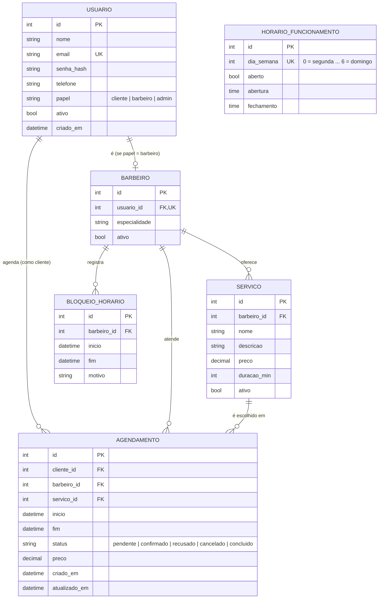

# Modelo de dados

Modelo lógico do sistema de agendamento para barbearias. Ele cobre os 18 requisitos funcionais do backlog; a coluna **RF** de cada tabela mostra quais requisitos dependem dela.

Stack: Django 5 + PostgreSQL (SQLite em desenvolvimento) — ver [ADR 0001](adr/0001-stack-tecnologica.md).

## Diagrama entidade-relacionamento

## Dicionário de dados

### usuario

Toda pessoa que entra no sistema. No Django é o modelo de usuário customizado (estende `AbstractUser`), com login por e-mail.

| Campo | Tipo | Regras |
|---|---|---|
| id | inteiro | PK |
| nome | texto (120) | obrigatório |
| email | texto (254) | obrigatório, **único**, usado no login |
| senha_hash | texto | gerado pelo Django (PBKDF2), nunca a senha em texto |
| telefone | texto (20) | opcional |
| papel | enum | `cliente`, `barbeiro` ou `admin`; padrão `cliente` |
| ativo | booleano | padrão verdadeiro; desativar em vez de apagar |
| criado_em | data/hora | automático |

**RF:** RF01, RF02, RF03, RF17

### barbeiro

Perfil profissional de um usuário com papel `barbeiro` (relação 1:1).

| Campo | Tipo | Regras |
|---|---|---|
| id | inteiro | PK |
| usuario_id | FK → usuario | obrigatório, **único** |
| especialidade | texto (100) | obrigatório |
| ativo | booleano | barbeiro inativo não aparece para agendamento |

**RF:** RF04, RF09, RF17

### servico

Serviço oferecido por um barbeiro (cada barbeiro cadastra os seus, conforme RF12).

| Campo | Tipo | Regras |
|---|---|---|
| id | inteiro | PK |
| barbeiro_id | FK → barbeiro | obrigatório |
| nome | texto (100) | obrigatório |
| descricao | texto | opcional |
| preco | decimal (8,2) | obrigatório, > 0 |
| duracao_min | inteiro | obrigatório, entre 5 e 480 |
| ativo | booleano | serviço inativo não pode ser agendado |

**RF:** RF12, RF13

### horario_funcionamento

Um registro por dia da semana (7 linhas no máximo). Configurado pelo admin.

| Campo | Tipo | Regras |
|---|---|---|
| id | inteiro | PK |
| dia_semana | inteiro (0–6) | **único** |
| aberto | booleano | se falso, o dia não tem horários |
| abertura | hora | obrigatório se `aberto` |
| fechamento | hora | obrigatório se `aberto`; `fechamento > abertura` |

**RF:** RF18, RF05

### bloqueio_horario

Intervalo em que um barbeiro não atende (folga, consulta médica etc.).

| Campo | Tipo | Regras |
|---|---|---|
| id | inteiro | PK |
| barbeiro_id | FK → barbeiro | obrigatório |
| inicio | data/hora | obrigatório |
| fim | data/hora | obrigatório; `fim > inicio` |
| motivo | texto (200) | opcional |

**RF:** RF10, RF05

### agendamento

O registro central do sistema.

| Campo | Tipo | Regras |
|---|---|---|
| id | inteiro | PK |
| cliente_id | FK → usuario | obrigatório; o usuário precisa ter papel `cliente` |
| barbeiro_id | FK → barbeiro | obrigatório |
| servico_id | FK → servico | obrigatório; o serviço precisa ser do mesmo barbeiro |
| inicio | data/hora | obrigatório; no futuro |
| fim | data/hora | calculado: `inicio + servico.duracao_min` |
| status | enum | `pendente` (padrão), `confirmado`, `recusado`, `cancelado`, `concluido` |
| preco | decimal (8,2) | cópia do preço do serviço no momento do agendamento |
| criado_em | data/hora | automático |
| atualizado_em | data/hora | automático |

**RF:** RF05, RF06, RF07, RF08, RF09, RF11, RF14, RF15, RF16

## Regras de negócio que o modelo precisa garantir

1. **Sem conflito de horário:** um barbeiro não pode ter dois agendamentos `pendente` ou `confirmado` que se sobreponham (`novo.inicio < existente.fim` **e** `novo.fim > existente.inicio`).
2. **Dentro do funcionamento:** o intervalo `inicio–fim` precisa caber inteiro no `horario_funcionamento` do dia da semana, e o dia precisa estar `aberto` (RF05 depende de RF18).
3. **Fora de bloqueios:** o intervalo não pode cruzar nenhum `bloqueio_horario` do barbeiro (RF10).
4. **Serviço coerente:** `servico.barbeiro_id` precisa ser igual a `agendamento.barbeiro_id`, e serviço e barbeiro precisam estar ativos.
5. **Cancelamento:** só o próprio cliente cancela, e só agendamentos `pendente` ou `confirmado` que ainda não começaram (RF07).
6. **Confirmação:** só o barbeiro do agendamento muda `pendente` para `confirmado` ou `recusado` (RF11).

As regras 1 a 4 ficam numa função de serviço (`agendamentos/services.py`) chamada antes de salvar, e cada uma ganha um teste automatizado — elas são o núcleo da matriz de rastreabilidade (Ficha 3).

## Decisões de modelagem

| Decisão | Motivo |
|---|---|
| **Uma barbearia só** (sem tabela `barbearia`) | O escopo do MVP é uma barbearia. Multi-barbearia fica como evolução; adicionar a tabela depois é uma migration. |
| **`fim` gravado, não só calculado** | Deixa a checagem de conflito uma consulta simples por intervalo e permite índice em `(barbeiro_id, inicio, fim)`. |
| **`preco` copiado no agendamento** | Se o barbeiro mudar o preço do serviço, o histórico do cliente (RF08) continua mostrando o valor combinado. |
| **Desativar em vez de apagar** (`ativo`) | Apagar um barbeiro ou serviço quebraria o histórico de agendamentos (RF08, RF16). |
| **Sem tabela de notificações** | RF14/RF15 são *Could*: o e-mail é disparado na criação do agendamento, sem precisar guardar estado. |
| **Papel no próprio usuário** | Três papéis fixos não justificam tabela de perfis; `barbeiro` existe à parte só porque tem dados próprios (especialidade). |
