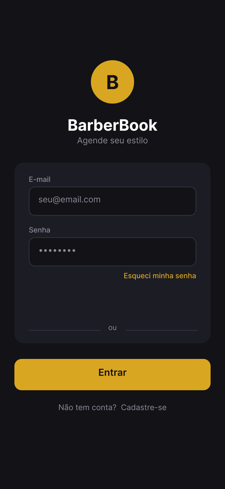
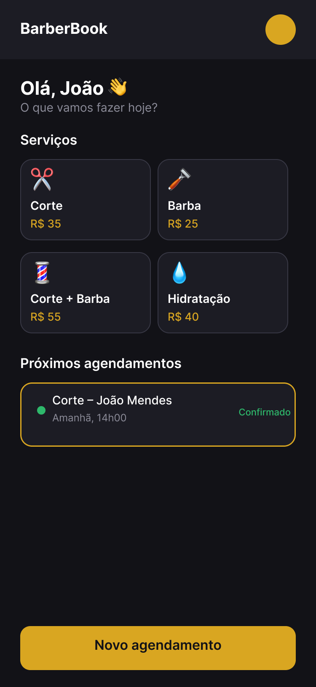
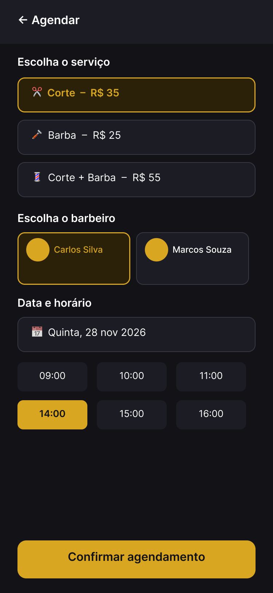
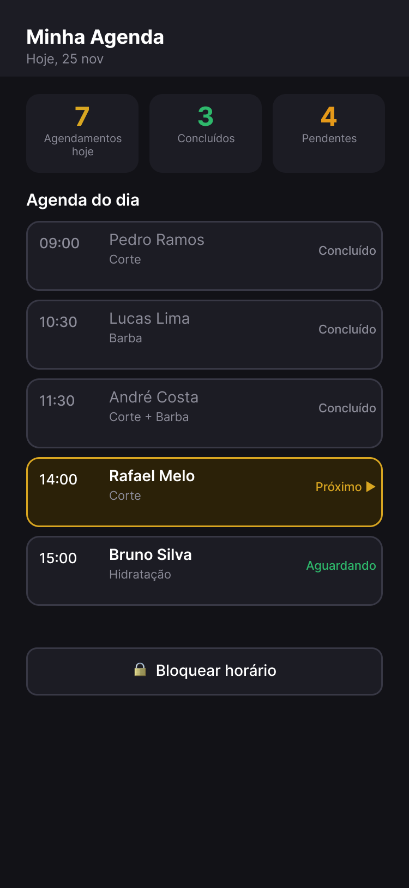
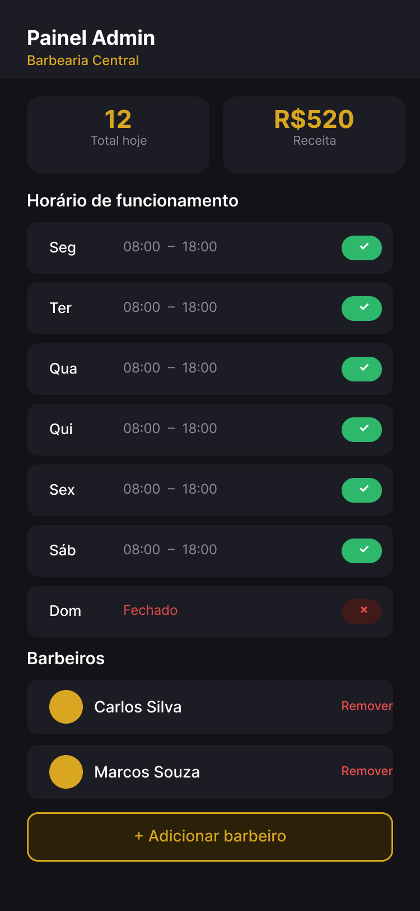

# Protótipo de interface

Protótipo de alta fidelidade das telas principais, feito no Figma para celular (375 × 812, exportado em 2x). Segue o RNF03: a interface deve funcionar em dispositivos móveis.

**Figma:** <https://www.figma.com/design/ZZWuGeh6vUCyO3zgZYJ0MD>

No protótipo, o produto aparece com o nome **BarberBook**, que é o nome de marca do sistema "Barbearia Agendamento".

## Telas

| | | |
|---|---|---|
|  |  |  |
| **1 · Login** | **2 · Home (serviços)** | **3 · Agendamento** |
|  |  | |
| **4 · Dashboard do barbeiro** | **5 · Painel admin** | |

## Rastreabilidade: tela → requisito

| Tela | Perfil | O que mostra | Requisitos |
|---|---|---|---|
| 1 · Login | Todos | E-mail, senha, link para cadastro | RF02, RF03 |
| 2 · Home | Cliente | Serviços com preço e próximos agendamentos com status | RF13, RF08 (parcial) |
| 3 · Agendamento | Cliente | Escolha de serviço, barbeiro, data e horários livres | RF05, RF06 |
| 4 · Dashboard do barbeiro | Barbeiro | Agenda do dia com contadores e botão para bloquear horário | RF09, RF10 |
| 5 · Painel admin | Admin | Horário de funcionamento por dia, lista de barbeiros, adicionar e remover | RF18, RF17 |

O fluxo das telas 2 → 3 corresponde às tarefas da raia **Cliente** no [BPMN](../bpmn/), e a tela 4 corresponde à raia **Barbearia**.

## Lacunas encontradas na revisão

Na comparação com o backlog e o modelo de dados, apareceram itens para a próxima versão do protótipo:

### Telas que ainda não existem

| Tela que falta | Requisitos | Prioridade |
|---|---|---|
| Cadastro de cliente e de barbeiro | RF01, RF04 | **Must** |
| Meus agendamentos, com opção de cancelar | RF07, RF08 | **Must** / Should |
| Cadastro de serviços (barbeiro) | RF12 | **Must** |
| Lista de todos os agendamentos (admin) | RF16 | Should |

### Ajustes nas telas atuais

- **Dashboard do barbeiro:** faltam os botões **Confirmar / Recusar** para agendamentos pendentes (RF11). Os status da tela ("Próximo", "Aguardando") também devem seguir os do modelo de dados (`pendente`, `confirmado`, `concluido`...).
- **Dashboard do barbeiro:** se o registro de falta (no-show) entrar como RF19, a tela precisa de uma ação "Marcar falta".
- **Home e Agendamento:** mostrar a **duração** do serviço junto com o preço (RF12/RF13).
- **Home:** no nosso modelo, os serviços são cadastrados por barbeiro (RF12). A tela deve deixar claro que os preços podem variar conforme o barbeiro, ou o modelo deve mudar para serviços da barbearia.
- **Login:** existe um divisor "ou" sem nenhuma opção abaixo dele. Ou se remove o divisor, ou se adiciona a opção (por exemplo, login com Google, que hoje está fora do escopo).
- **Painel admin:** o indicador "Receita" não tem requisito correspondente. Pode virar um requisito *Could* ou sair da tela.
